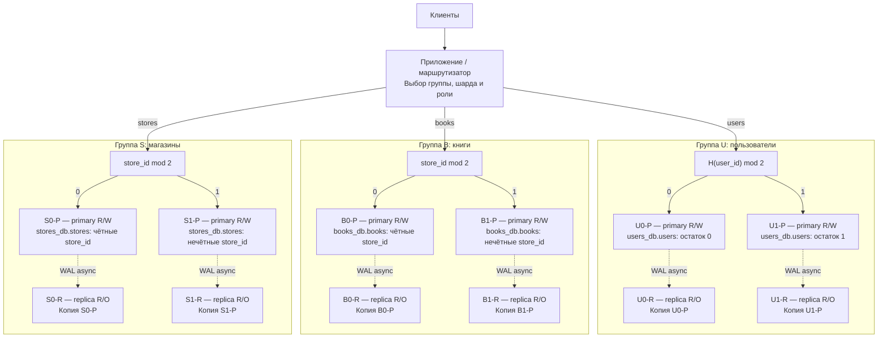

# Домашнее задание «Репликация и масштабирование. Часть 2»

**Студент:** Степанов Андрей

**Занятие:** 12-07

**Условия:** [задание Нетологии](https://github.com/netology-code/sdb-homeworks/blob/main/12-07.md)

## Задание 1. Преимущества схем репликации

### Активный master и пассивный slave

Master принимает запросы приложения на чтение и изменение данных. Slave получает и применяет изменения master, но в обычном режиме не обслуживает пользовательскую нагрузку.

Преимущества:

- **Повышение доступности.** При отказе master реплику можно повысить до нового master и переключить на неё приложение. Это быстрее, чем разворачивать сервер и восстанавливать всю БД из резервной копии.
- **Плановое обслуживание.** Можно дождаться применения изменений на реплике и перенести нагрузку на неё на время обслуживания основного узла.
- **Простая организация записи.** Изменения принимает один узел, поэтому нет конфликтов между несколькими одновременно пишущими master.

Основная цель этой схемы — отказоустойчивость. Пассивный slave не увеличивает производительность текущих запросов: они по-прежнему выполняются на master. Для переключения нужны контроль состояния, повышение реплики и изменение маршрутизации. Репликация сама по себе не обеспечивает автоматический failover.

При асинхронной репликации slave может отставать: при аварии master возможна потеря последних подтверждённых записей. Синхронное подтверждение записи на резервном узле уменьшает этот риск ценой задержки операций и зависимости записи от доступности реплики. Репликация не заменяет резервное копирование: ошибочное удаление данных также попадёт на slave. См. [документацию PostgreSQL о потоковой и синхронной репликации](https://www.postgresql.org/docs/16/warm-standby.html).

### Master и несколько slave

Master обслуживает запись и чтение, для которого необходимы самые свежие данные. Несколько slave содержат копии данных и принимают запросы только на чтение; в PostgreSQL это режим hot standby.

Преимущества:

- **Масштабирование чтения.** Запросы распределяются между репликами, что позволяет обслуживать больше читателей и разгружает master.
- **Разделение нагрузки.** Отчёты и аналитические SELECT можно выполнять на выделенной реплике, снижая их влияние на основные запросы.
- **Больше вариантов восстановления.** При отказе одной реплики чтение направляется на остальные. При отказе master одна из подходящих реплик может стать новым master.
- **Географическое распределение.** Реплики ближе к пользователям могут уменьшить сетевую задержку чтения.

Запросы распределяет приложение или прокси, различающий чтение и запись. Асинхронные реплики могут показывать устаревшие данные, поэтому чтение сразу после записи направляется на master либо выполняется после ожидания применения нужной записи на выбранной реплике. Режим hot standby и его ограничения описаны в [документации PostgreSQL](https://www.postgresql.org/docs/current/hot-standby.html).

Добавление slave не распределяет запись: все изменения по-прежнему проходят через один master. Каждая реплика хранит копию данных и требует ресурсов на передачу и применение изменений. Для увеличения суммарной ёмкости и производительности записи применяется шардинг.

## Задание 2. План вертикального и горизонтального шардинга

### 1. Исходная модель

Рассматриваю систему книжных магазинов с тремя таблицами:

| Таблица | Столбцы | Назначение |
|---|---|---|
| `users` | `user_id UUID PK`, `full_name`, `email`, `registered_at` | Пользователи |
| `books` | `store_id BIGINT`, `book_id UUID`, `isbn`, `title`, `author`, `price`, `stock`; PK (`store_id`, `book_id`) | Книжные предложения магазинов |
| `stores` | `store_id BIGINT PK`, `name`, `region`, `address` | Магазины |

Одна книга может продаваться в разных магазинах с разными ценами и остатками. Поэтому строка `books` привязана к магазину, а ISBN не является уникальным идентификатором строки. Предполагаю, что основные запросы к книгам выполняются по магазину, а пользователи читаются по `user_id`.

### 2. Вертикальное разделение

Распределяю таблицы по функциональным областям на независимые БД и серверные группы:

| Группа | База данных | Содержимое |
|---|---|---|
| U — пользователи | `users_db` | Только `users` |
| B — книжные предложения | `books_db` | Только `books` |
| S — магазины | `stores_db` | Только `stores` |

Это вертикальный шардинг на уровне таблиц, или функциональное разделение. Он позволяет отдельно выделять ресурсы и масштабировать наиболее нагруженную область. Например, рост каталога не требует увеличивать сервер пользователей. Три БД на одном физическом сервере сами по себе не распределяют аппаратную нагрузку.

В узком смысле вертикальное разбиение означает разделение **столбцов одной таблицы**. Например, `users` можно разделить на `users_identity(user_id, email)` и `users_profile(user_id, full_name, registered_at)` в разных БД; исходная запись собирается по общему `user_id`. Это отдельный вариант; в основной схеме ниже разделяются целые таблицы.

### 3. Горизонтальное разделение

Внутри каждой группы распределяю **строки** между двумя шардами с одинаковой структурой таблицы. Каждый шард размещается на собственном primary-сервере.

Для пользователей: `shard = H(user_id) mod 2`, где H — фиксированная хеш-функция от UUID, одинаковая во всех экземплярах приложения. Для магазинов и книг: `shard = store_id mod 2`, где `store_id` положительный. Книги распределяются по магазину из-за преобладания запросов «показать книги магазина».

| Primary-сервер | БД и таблица | Условие размещения строк | Пример |
|---|---|---|---|
| `U0-P` | `users_db.users` | `H(user_id) mod 2 = 0` | Пользователь с чётным результатом хеша |
| `U1-P` | `users_db.users` | `H(user_id) mod 2 = 1` | Пользователь с нечётным результатом хеша |
| `B0-P` | `books_db.books` | `store_id mod 2 = 0` | Книги магазина 102 |
| `B1-P` | `books_db.books` | `store_id mod 2 = 1` | Книги магазина 101 |
| `S0-P` | `stores_db.stores` | `store_id mod 2 = 0` | Магазин 102 |
| `S1-P` | `stores_db.stores` | `store_id mod 2 = 1` | Магазин 101 |

Правила выбраны для учебного примера. Перед внедрением нужно проверить распределение объёма и запросов: один очень крупный магазин может перегрузить свой шард. Номер шарда книг и соответствующего магазина совпадает, но это разные серверы и БД; локальный JOIN между ними не появляется.

### 4. Блок-схема размещения

Сплошные стрелки — маршрутизация запросов, пунктирные — потоковая репликация внутри пары одного шарда.

Всего: 6 независимых primary и 6 их реплик. Каждый узел `*-P` или `*-R` — отдельный экземпляр PostgreSQL на отдельном сервере/ВМ. Primary и его реплика размещаются в разных доменах отказа. Схема показывает путь записи и актуального чтения через primary; SELECT с допустимым отставанием маршрутизатор может отправлять прямо на соответствующий `*-R`.

### 5. Режимы серверов

| Роль | Режим работы |
|---|---|
| `*-P` — primary/master | INSERT, UPDATE, DELETE и актуальные SELECT только своего шарда. Между primary разных шардов репликации нет |
| `*-R` — replica/slave | Получение WAL только от своего primary; hot standby: SELECT разрешены, запись приложения запрещена |
| Приложение / маршрутизатор | Выбор группы и шарда по ключу; запись и чтение после записи — на primary, остальные чтения при допустимом отставании — на реплику |

Выбираю асинхронную потоковую репликацию: она снижает задержку записи, но допускает отставание и потерю последних изменений при аварийном переключении. Для подтверждения сохранения WAL на резервном сервере до ответа клиенту можно выбрать синхронную репликацию внутри каждой пары. При этом растут задержки, а запись может ждать недоступную синхронную реплику. См. [документацию PostgreSQL](https://www.postgresql.org/docs/17/warm-standby.html).

Failover выполняется отдельно для каждого шарда: проверка реплики, изоляция старого primary от записи, повышение реплики, обновление маршрута. Изоляция предотвращает split-brain. После восстановления старый узел присоединяется как реплика нового primary. Автоматизация требует отдельного механизма координации.

### 6. Связность данных и запросы

- `user_id` и `book_id` создаются как UUID, `store_id` выдаётся общим генератором. Независимые локальные счётчики без выделенных диапазонов могут вызвать коллизии.
- Ключ книг — (`store_id`, `book_id`). Обычный внешний ключ PostgreSQL между независимыми БД невозможен, поэтому существование магазина и согласованное удаление его предложений контролирует сервис.
- Запрос книги по (`store_id`, `book_id`) обращается к одному шарду. Поиск только по ISBN, поиск пользователя по email и общая статистика требуют опроса всех соответствующих шардов с объединением результатов либо отдельного индекса.
- Если нужна глобальная уникальность email, её обеспечивает согласованный реестр: локального UNIQUE на каждом шарде недостаточно.
- Обычная транзакция ограничена одной БД. Изменения в нескольких БД требуют координации приложения, например саги с повторяемыми операциями и компенсациями.
- Ключ шардинга желательно не менять. Перенос предложения в другой магазин может потребовать переноса строки между шардами.

### 7. План внедрения и расширения

1. Измерить объём таблиц, частоту запросов и долю чтения/записи; проверить выбранные ключи на перекос нагрузки.
2. Сделать резервную копию, развернуть серверы трёх групп, одинаковые схемы двух шардов в каждой группе, индексы, роли доступа и репликацию.
3. Реализовать централизованные правила маршрутизации, обработку недоступности узлов и объединение межшардовых результатов.
4. Перенести согласованный снимок данных по правилам распределения. Для простой миграции остановить запись на время финального переноса; для короткой паузы дополнительно переносить изменения, накопившиеся после снимка.
5. Сверить количество строк и контрольные суммы, проверить отсутствие дубликатов и потерянных связей, затем переключить приложение. Проверить запись, чтение после записи и восстановление при отказе primary.
6. Контролировать задержку репликации, объём WAL, свободное место, CPU, дисковый ввод-вывод и баланс нагрузки. Настроить независимые резервные копии и проверку восстановления.
7. При добавлении шардов управляемо перераспределить данные. Нельзя просто заменить `mod 2` на `mod 3`: изменятся маршруты существующих строк. Для дальнейшего роста ввести виртуальные корзины и таблицу их соответствия физическим шардам, чтобы переносить отдельные корзины с контролируемым переключением маршрутов.

Вертикальный шардинг распределяет функциональные области по разным БД, горизонтальный — строки каждой области между серверами, а репликация обеспечивает резервирование каждого шарда и дополнительное масштабирование чтения.
